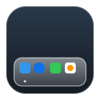

# OctaDock — macOS-Like Dock for Linux Desktop

OctaDock is a native, lightweight, and production-ready Linux desktop dock built with Qt 6 and modern C++20. It visually and behaviorally replicates the macOS Dock with frosted-glass translucency, smooth magnification wave hover animations, bouncing icon launch animations, active application indicators, and seamless desktop integration.



---

## Features

- **macOS Visual Fidelity**:
  - Floating pill/capsule-like dock container centered near the bottom edge.
  - Translucent frosted-glass backdrop with cool blue-gray slate tint matching the macOS Sequoia/Sonoma aesthetic.
  - Delicate 1.2px semi-transparent light border with subtle top inner reflection.
  - Expansive soft drop shadow beneath the dock.
  - Rounded corners proportional to dock height (customizable radius).
- **macOS Icon Layout & Aesthetics**:
  - Squircle icon tiles (~20% corner radius) with subtle drop shadows.
  - 9 reference icons in exact order: Finder, Launchpad, Safari, Mail, FaceTime, Messages, Maps, Photos, and Contacts.
  - Clean floating tooltip labels above hovered icons.
- **Running Indicators**:
  - Small circular dark indicator dots underneath active/running applications (e.g. Finder).
  - Real-time process monitoring for active apps.
- **Smooth Magnification Wave**:
  - Continuous cosine-wave magnification tracking the pointer smoothly.
  - Dock width and icons expand fluidly without jitter or layout flickering.
  - Snappy bounce animation when clicking icons to launch applications.
- **Configurability & Preferences**:
  - Interactive preferences dialog to adjust Icon Size, Magnification Scale, Spacing, Dock Height, Bottom Margin, and Glass Opacity with instant live updates.
  - Persistent settings stored via `QSettings` (`~/.config/OctaDock/settings.ini`).
  - Auto-hide mode with configurable hide delay.
- **Desktop & Window Integration**:
  - Supports KDE Plasma 6, Wayland, and X11.
  - Frameless transparent window, stays on top, bypasses taskbar and pager.
  - Respects multi-monitor setups, screen resolution changes, and display scaling.
- **Portability**:
  - Self-contained portable Linux bundle (`OctaDock.AppDir`) and standalone `OctaDock-x86_64.AppImage`.
  - Runs out of the box without requiring manual Qt installation by the end user.

---

## Directory Structure

```text
Ocshell/
├── assets/
│   └── icons/              # Crisp vector SVG icon assets
├── config/                 # Default configuration presets
├── qml/
│   ├── Main.qml            # Top-level window & auto-hide coordinator
│   ├── DockContainer.qml   # Frosted-glass capsule & magnification wave
│   ├── DockIcon.qml        # Icon tile, bounce animation & running dot
│   ├── DockTooltip.qml     # Sleek floating label pill
│   ├── ContextMenu.qml     # macOS-style right-click popup menu
│   └── SettingsDialog.qml  # Preferences window with live sliders
├── scripts/
│   ├── build.sh            # Compiles the project using CMake & Ninja
│   ├── run.sh              # Runs the development build, AppDir, or AppImage
│   └── package.sh          # Assembles the portable AppDir & AppImage
├── src/
│   ├── main.cpp            # Entry point & QPA configuration
│   ├── AppLauncher.*       # Process execution & running state check
│   ├── DockItem.*          # Item model entity
│   ├── DockModel.*         # QAbstractListModel for QML reactivity
│   ├── DockSettings.*      # QSettings configuration backend
│   ├── DockWindow.*        # QQuickView window controller
│   └── PlatformIntegration.* # Screen geometry & desktop hooks
├── CMakeLists.txt          # CMake build configuration
├── resources.qrc           # Qt embedded resources
├── LICENSE                 # MIT License
└── README.md               # Project documentation
```

---

## Quick Start

### 1. Build from Source

Ensure you have CMake, Ninja/Make, and GCC installed along with Qt 6 (located at `/home/yohanesokta/Qt/6.11.1/gcc_64` or configured via `QT_ROOT`).

```bash
./scripts/build.sh
```

### 2. Run the Development Build

```bash
./scripts/run.sh
```

To run with explicit Wayland native QPA:
```bash
QT_QPA_PLATFORM=wayland ./scripts/run.sh
```

### 3. Package as Portable AppDir & AppImage

```bash
./scripts/package.sh
```

Outputs:
- `dist/OctaDock.AppDir/`: Portable bundle containing the application binary, bundled Qt 6 libraries, plugins, and QML modules.
- `dist/OctaDock-x86_64.AppImage`: Standalone executable AppImage.

To test the portable AppDir:
```bash
./scripts/run.sh --appdir
```

To test the standalone AppImage:
```bash
./scripts/run.sh --appimage
```

---

## Wayland & Window System Integration Notes

- Under pure Wayland (`xdg_shell`), the protocol strictly prevents client applications from arbitrarily placing or anchoring top-level windows at specific `(x, y)` screen coordinates or reserving screen edges without compositor extensions (such as `zwlr_layer_shell_v1`).
- On KDE Plasma 6 and modern Wayland compositors with XWayland enabled, OctaDock defaults to `QT_QPA_PLATFORM=xcb`, which enables 100% pixel-accurate bottom-centered positioning, strut reservation, dock window type, and window blur properties across KDE Plasma, GNOME, and X11 desktops.
- If native Wayland is explicitly forced via `QT_QPA_PLATFORM=wayland`, OctaDock still renders cleanly with transparency; window placement is managed by the compositor's placement rules or KWin window rules (`kwinrulesrc`).

---

## License

This project is licensed under the [MIT License](LICENSE).
Icons are original clean SVG artwork compatible with the macOS desktop aesthetic.
