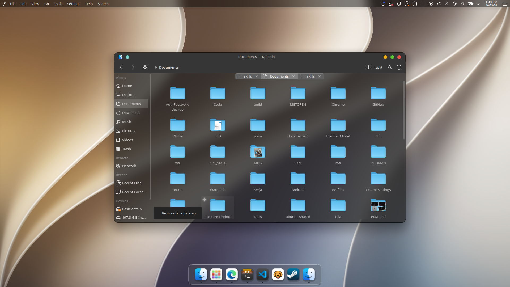

# OctaDock — macOS-Like Dock for Linux Desktop



---

## Quick Start

### 1. Build from Source

Ensure you have CMake, Ninja/Make, and GCC installed along with Qt 6 (located at `/home/yohanesokta/Qt/6.11.1/gcc_64` or configured via `QT_ROOT`).

```bash
./scripts/build.sh
```

### 2. Run the Development Build

```bash
./scripts/run.sh
```

To run with explicit Wayland native QPA:
```bash
QT_QPA_PLATFORM=wayland ./scripts/run.sh
```

### 3. Package as Portable AppDir & AppImage

```bash
./scripts/package.sh
```

Outputs:
- `dist/OctaDock.AppDir/`: Portable bundle containing the application binary, bundled Qt 6 libraries, plugins, and QML modules.
- `dist/OctaDock-x86_64.AppImage`: Standalone executable AppImage.

To test the portable AppDir:
```bash
./scripts/run.sh --appdir
```

To test the standalone AppImage:
```bash
./scripts/run.sh --appimage
```

---

## Wayland & Window System Integration Notes

- Under pure Wayland (`xdg_shell`), the protocol strictly prevents client applications from arbitrarily placing or anchoring top-level windows at specific `(x, y)` screen coordinates or reserving screen edges without compositor extensions (such as `zwlr_layer_shell_v1`).
- On KDE Plasma 6 and modern Wayland compositors with XWayland enabled, OctaDock defaults to `QT_QPA_PLATFORM=xcb`, which enables 100% pixel-accurate bottom-centered positioning, strut reservation, dock window type, and window blur properties across KDE Plasma, GNOME, and X11 desktops.
- If native Wayland is explicitly forced via `QT_QPA_PLATFORM=wayland`, OctaDock still renders cleanly with transparency; window placement is managed by the compositor's placement rules or KWin window rules (`kwinrulesrc`).

---

## License

This project is licensed under the [MIT License](LICENSE).
Icons are original clean SVG artwork compatible with the macOS desktop aesthetic.
